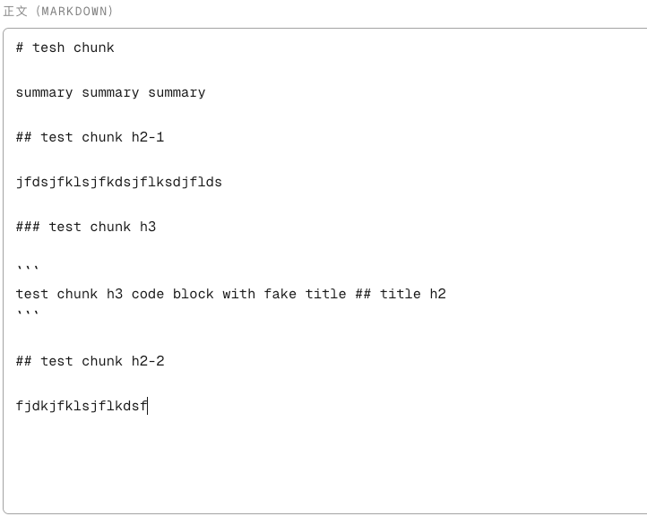
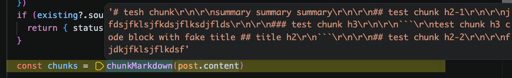

# content to chunk

网页端提交的 content 内容截图：

实际在代码中看到的 code

## `\r` 与 `\n`

这段 `post.content` 里，`\r` 和 `\n` 始终成对出现，写成 `\r\n`。这一对就是编辑器里的一次换行。

- `\r`：回车（Carriage Return，CR）。把光标拉回行首。
- `\n`：换行（Line Feed，LF）。进入下一行。

它们各是一个控制字符。调试器里的 `\r`、`\n` 是这两个不可见字符的写法，不是反斜杠加字母。

网页正文按行显示。代码里的字符串是同一段文字，调试器用 `\r\n` 标出换行。调试器把长字符串折成多行显示，折行处没有 `\r` 或 `\n`，那些不是正文换行。例如 `j` 和 `fdsjfkls…` 之间、`c` 和 `ode block` 之间、`f` 和 `jdkjfk…` 之间都是显示折行。

| 编辑器里看到的 | 字符串里对应的结尾 |
| --- | --- |
| `# tesh chunk` 后面空一行 | `\r\n\r\n` |
| `summary summary summary` 后面空一行 | `\r\n\r\n` |
| 各级标题、普通段落后面空一行 | `\r\n\r\n` |
| 代码块三个反引号和里面那一行之间 | 只有一个 `\r\n`，代码块内部没有空行 |
| 最后一行 `fjdkjfklsjflkdsf` | 后面没有 `\r\n` |

`\r\n\r\n` 表示这一行结束，再插入一个空行。代码块内部只有单个 `\r\n`，所以围栏和代码贴在一起。

这里用的是 Windows 风格的 CRLF。macOS 文本通常只有 `\n`。这段是网页提交后在代码里看到的 `post.content`，内容已经被存成 `\r\n`。切片时要把 `\r\n` 当成一个换行，不要把 `\r` 和 `\n` 各算一次。
